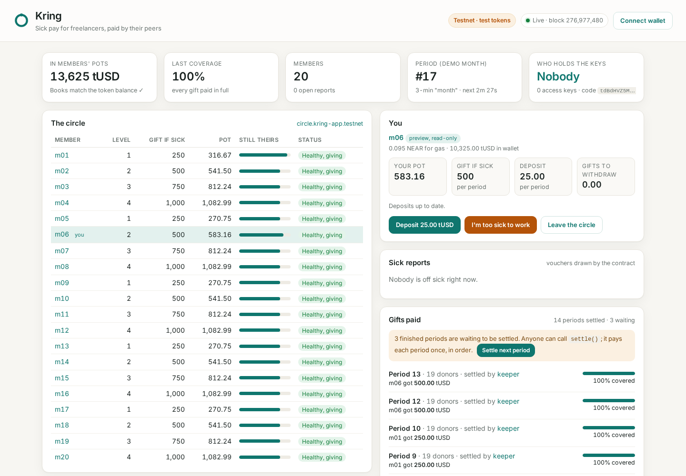

# Kring: sick pay for freelancers, paid by their peers

Freelancers don't get sick pay. Kring lets a small circle of freelancers who know each other cover one another: everyone parks a small deposit in their own pot each month, and when one of them is too sick to work, the others' pots send a monthly gift.

**The chain replaces the bank, the board and the admin, not the trust.** Circles are invite-only. Members admit each other by vote, and any one member can veto. When someone reports sick, the contract draws two members to vouch, which only stops a claimant picking their own friends. There's no single admin; any change needs a member vote. The circle's account has zero access keys, so nobody, including me, can move the money outside the rules.

- **Status:** Testnet prototype with test tokens; any real deployment needs legal review in each jurisdiction.
- **Not insurance:** nothing is promised. If the pots can't cover a month, every gift scales down by the same ratio, and the coverage ratio is stored on chain.
- **Wallets:** members need a NEAR wallet today and pay their own (tiny) gas. Sponsored gas comes next.
- **Inspiration:** Dutch gift circles (schenkkringen, such as Broodfonds), where 20 to 50 self-employed people already do this offline. Kring borrows the idea only. It isn't affiliated with any of them.
- **Live UI:** https://pravinrajv.github.io/kring/ reads the testnet circle in real time. It's read-only unless a member connects their own wallet.
- **Built by:** Pravinraj Vincent, independent developer, for NEAR HACKATHON (Nov 2026). Tracks: Social Money, Real-World Money.

## Try it (do X, see Y)

| # | Do this | You'll see | Needs |
|---|---|---|---|
| 1 | `./scripts/prove-keyless.sh` | `access keys 0` and `RESULT PASS`: the live testnet circle has no keys and runs exactly `res/kring_circle.wasm` | curl, python3 (10 seconds) |
| 2 | `./demo.sh` | Unit tests, the 20-member simulation, then a full circle on a local NEAR node: deposits, an outsider refused, probation, a sick report, a non-drawn voucher refused, gifts after the waiting period, withdrawal, a vetoed admission, a majority admission, an exit, and books that match the token balance to the unit. Ends with `E2E PASSED` and `Kring ran end to end.` | Node 20+, curl, python3; Rust optional (about 6 minutes) |
| 3 | `cd ui && npm ci && npm run build && npm run preview`, then open http://localhost:4173 | The live testnet circle on one screen: pots, coverage, who's sick, who vouched, gifts paid, member votes and the zero-keys check, refreshed every 8 seconds | Node 20+ |
| 4 | `node e2e/upgrade-by-vote.mjs` | A keyless circle on a local node refuses an upgrade with 13 of 20 votes, refuses different code with 14, then upgrades with 14 and the approved code, with every pot unchanged | Node 20+ (about 4 minutes) |
| 5 | `cargo test --workspace` | 61 tests pass (58 circle, 3 token). Every attack in [THREAT_MODEL.md](THREAT_MODEL.md) has at least one | Rust 1.95+ |

No step needs a NEAR account or key. Step 3 lets members act if they connect a testnet wallet, but reading needs nothing. Add `?as=m06.kring-app.testnet` to see one member's own view (read-only), or `?circle=<account>&rpc=<url>` to point it at another circle or RPC.



## What's live on NEAR testnet

All of it is in [deployments/testnet.json](deployments/testnet.json), and every hash opens on [testnet.nearblocks.io](https://testnet.nearblocks.io).

| What | Account or transaction |
|---|---|
| Circle (20 demo members, 3-minute "months") | [`circle.kring-app.testnet`](https://testnet.nearblocks.io/address/circle.kring-app.testnet) |
| Test token tUSD (no value) | [`tusd.kring-app.testnet`](https://testnet.nearblocks.io/address/tusd.kring-app.testnet) |
| Deploy, init and delete the only key, in one transaction | [`7vmMF1n3…`](https://testnet.nearblocks.io/txns/7vmMF1n3gKZnoeo3ARnuVkz2AUeP4cvSZaabTEi5pM4S) |
| m01 reports sick, two drawn members vouch | [`DkecUusU…`](https://testnet.nearblocks.io/txns/DkecUusU3hNVYQZDmY5gakDwKGkP4R4aDnjLR2tcBr5g), [`CsyYSmuG…`](https://testnet.nearblocks.io/txns/CsyYSmuGNN3eS2Nit39Lc5WRxWST6VGAHuki57vbtX7e), [`rrpYt9N6…`](https://testnet.nearblocks.io/txns/rrpYt9N6GyAxM9XSzE7MkhiNZuMdEVtrWuEFSigfMTX) |
| First gift settled (period 2, 100% covered) and withdrawn | [`BHrRDqKW…`](https://testnet.nearblocks.io/txns/BHrRDqKWRaML4oFGjrsYd8ybc9MedfFei1eSRpM4pjyy), [`E6byNf9k…`](https://testnet.nearblocks.io/txns/E6byNf9k4eQP6KjXSdRcKdm7TzKg12E7PR9K7zr5jMXL) |
| Code upgrade by member vote: proposal #0, 14 of 20 approve, executed | [`FnWpG1ic…`](https://testnet.nearblocks.io/txns/FnWpG1icEWyrBSKqwmKi7X1BhpbCQypw13AAd3ziNsas), [`GDuMwS2d…`](https://testnet.nearblocks.io/txns/GDuMwS2dXMWruR9PqyMRT2n5yM9MZdMdAhfGVCAF1pfq) |
| After the upgrade, a full claim on v2: m06 reports sick, m08 and m12 (drawn) vouch, gifts for periods 12 and 13 at 100%, withdrawal of 1,000 tUSD, recovery | [`7cTi51EK…`](https://testnet.nearblocks.io/txns/7cTi51EKxrahUM6cN47pXD7Vm5wgUYGQTUSyJNignxzQ), [`DsUoRhEY…`](https://testnet.nearblocks.io/txns/DsUoRhEYEMXnoPAVDE9ptob4X9vYNsVNboqMJS5fzk9x), [`B1SJsmKz…`](https://testnet.nearblocks.io/txns/B1SJsmKzGtWPoTecMn6eC92GXCnTMru6nrRXrvgD5VHg), [`7W3z4QLZ…`](https://testnet.nearblocks.io/txns/7W3z4QLZk92bAsTBNBcZyM3XMyz4Kab2QFqvHTeHb3jr), [`3iks5nR9…`](https://testnet.nearblocks.io/txns/3iks5nR9Ci13uyZk9VeS2CbaeduH4wJSAzvcpHkNcHBN), [`G7BiFveC…`](https://testnet.nearblocks.io/txns/G7BiFveCx9C8kM6rZEBMENN2yBeMFByVkhsv3w2AnYD5), [`BTesm2SF…`](https://testnet.nearblocks.io/txns/BTesm2SFWXopYGB38KRrjAG6khTpu3jiY4SU1gCx5XeD) |

The upgrade is worth a look. After deploy, nobody could change the code, so the v2 fixes (a storage bond on proposals and a clean exit for empty pots) went in the only way the contract allows: a member proposed the new code's sha256, 13 others approved, and the code was sent to `execute_upgrade`, which checked both the hash and the two-thirds vote.

To check every hash above from public archival RPC (sender, receiver, method, success), run `./scripts/verify-txs.py`.

The scripts that made these (`scripts/testnet/*.mjs`) read the demo accounts' testnet key from 1Password at run time. They're included so you can see exactly what was sent, but you don't need them to verify anything.

## How a circle works

| Step | Method | Rule |
|---|---|---|
| Join | `propose({kind:{type:"admit",...}})`, `approve`, `veto`, `execute` | Invite-only. More than half of active members approve after a veto window; one veto ends it. Proposals carry a 0.01 NEAR storage bond. |
| Pay in | `ft_transfer_call` on the token | Your deposit is your gift level divided by 20 each period, and it stays in **your own pot**. Deposits from anyone else are handed back. |
| Fall sick | `report_sick()` | Only after probation and with deposits up to date. The contract draws two vouchers from `env::random_seed`. You can't pick them, and nobody vouches for the same person twice in 12 periods. |
| Vouch | `vouch(claimant)` | Only the two drawn members. If they don't, anyone can `redraw` after the window. |
| Get gifts | `settle()` | Anyone can call it, once per finished period, in order. After a one-period wait, each healthy pot gives in proportion to its level. If pots run low, every gift scales down by the same ratio. At most 24 gift periods. |
| Recover | `report_recovered()` | Gifts stop from that period. |
| Take money out | `withdraw()` | Gifts any time. Your pot when your exit is final. Pull pattern; a failed transfer puts everything back. |
| Leave | `request_exit()` | You still give for the current period, so nobody can leave the moment a friend gets sick. |
| Change the code | `propose({kind:{type:"upgrade",code_hash}})`, then `execute_upgrade` | Two thirds of active members, and the code must match the approved sha256. |
| Remove a fake claimant | `propose({kind:{type:"expel",...}})` | A majority, not counting the member in question. Gifts stop at once. |

## Does it hold up? The simulation

[sim/SIMULATION.md](sim/SIMULATION.md) runs the real contract code for 20 members over 24 months under three labeled sickness assumptions (seed 2026, reproducible with `cargo run --example simulate -- 2026` in `contracts/circle`). It's a simulation, not data.

| Scenario | Gifts due | Gifts paid | Months below 100% | Lowest coverage |
|---|---|---|---|---|
| A. Baseline: 1% start a spell a month, about 4 months long | 17,000 | 17,000 | 0 | 100.0% |
| B. Two bad years: 3% a month, about 6 months long | 75,500 | 27,386 | 19 | 14.8% |
| C. Shock: baseline plus four long-term sick from month 3 | 113,000 | 24,235 | 20 | 12.8% |

The honest reading: in a normal year a 20-person circle that starts from empty pots pays every gift in full. In a bad year it can't, and the contract says so on chain rather than pretending. Offline circles handle this by starting with a buffer and capping circle size, which a real deployment would copy.

## What NEAR does here

- **A keyless account holds the pots.** Deploy, init and key deletion happen in one transaction, so there's never a moment when someone could keep a key. `prove-keyless.sh` checks it from public RPC.
- **Named accounts and NEP-141.** Members are readable accounts (`m01.kring-app.testnet`), and deposits use the standard `ft_transfer_call` flow from the token.
- **On-chain randomness.** `env::random_seed` draws vouchers. Block producers can bias it, which is why membership is invite-only and the draw only does one job (see the threat model).
- **Self-governed upgrades.** The contract deploys new code to itself only after a two-thirds vote on its hash. That happened live on testnet.
- **Cheap, predictable gas,** so a monthly deposit or a vouch costs a fraction of a cent.

## Security

[THREAT_MODEL.md](THREAT_MODEL.md) lists 15 attacks, each with a control and the tests that cover it. Known limits are stated there too: the seed can be biased by block producers, the demo wasm is a non-reproducible build (the proof checks the bytes in `res/`, not that you'd get the same bytes from your own build), and the circle's NEAR balance pays for its own storage. Anyone can top it up with a plain transfer.

## Repository layout

```
contracts/circle   the circle contract (Rust, near-sdk 5.30.1), math.rs, tests.rs, examples/simulate.rs
contracts/tusd     a test NEP-141 token with an open faucet. No value, testnet only
res/               the built wasm files and ABIs that are deployed
e2e/               sandbox-demo.mjs (full story on a local node), upgrade-by-vote.mjs
ui/                the one-screen UI (Vite, vanilla JS, NEAR Wallet Selector 10)
scripts/           build.sh, prove-keyless.sh, testnet/ (deploy, live-scenario, keeper, upgrade-by-vote)
sim/               simulation results
deployments/       testnet accounts, code hashes and transaction hashes
```

Rebuild the wasm with `./scripts/build.sh` (Rust 1.95+, `cargo-near` 0.23, and binaryen from `e2e/`, which lowers bulk-memory ops the NEAR VM still rejects).

## Disclosures

- **Code before the hackathon:** none. Everything here was written during NEAR HACKATHON, starting Nov 9, 2026.
- **Libraries:** near-sdk and near-contract-standards 5.30.1, near-workspaces 5.0.0, near-api-js, NEAR Wallet Selector 10.1.4, Vite 8, binaryen. I used AI coding assistants while building it.
- **Other projects:** this is my only NEAR HACKATHON entry.
- **Not included on purpose:** a meta-transaction relayer (cut to keep the scope honest) and a factory for many circles (one circle shows the idea).

## License

MIT, see [LICENSE](LICENSE).
